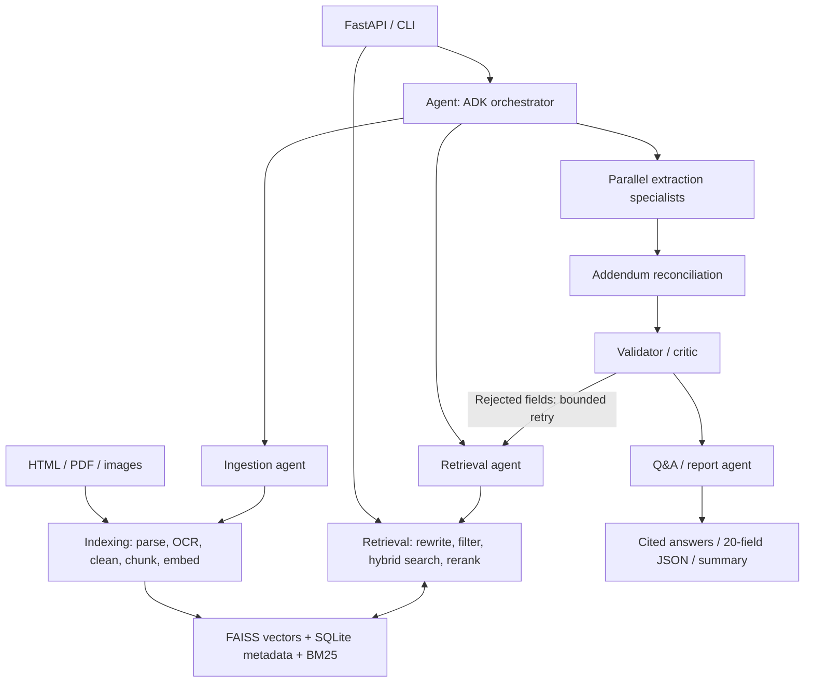

# RFP Intelligence Platform — proposed implementation

Original proposal, superseded where noted in README: the user subsequently selected Groq GPT-OSS 120B and requested a 1 GB / 1 vCPU deployment, so implementation uses small ONNX BGE embeddings and TinyBERT reranking.

Reviewed on October 25, 2026 against all seven pages of the supplied seven-page assignment, with inspection of the nine supplied bid documents. This is the design and coverage checklist; this original proposal is retained for context. The implemented choices and measured results are documented in README.md, ARCHITECTURE.md and artifacts/STATUS.md.

## Scope and architecture

Build a Python 3.11+ FastAPI application in this folder. Preserve the supplied Bid1 and Bid2 folders as inputs. Accept any new bid folder through the same ingestion pipeline; no bid-specific answers, filenames, or extraction logic.

Use Google ADK for agent construction and orchestration, with Pydantic contracts. ADK is the framework; A2A is the interoperability protocol. Keep local orchestration efficient and expose a real A2A-compatible root-agent endpoint through ADK's adapter. Verify interoperability with an A2A client. Separate remote agent services are unnecessary for this dataset. Pin compatible, tested ADK/A2A versions because the integration is documented as experimental.

## Required classes

| Class | Responsibility |
| --- | --- |
| `Indexing` | Own the entire indexing lifecycle: discover files, classify documents, parse text/tables/images, OCR, clean, attach metadata, chunk, embed, build/update indexes, persist, load and report failures. Parser helpers stay behind this class. |
| `Retrieval` | Own query rewriting/expansion, pre-search metadata constraints, dense and keyword retrieval, reciprocal rank fusion, cross-encoder reranking, deduplication and citation assembly. Usable independently and as an agent tool. |
| `Agent` | Application facade over Google ADK: build agents, create isolated run state, route extraction/Q&A, manage bounded validator feedback, produce outputs and record traces. Alias the imported ADK `Agent` to avoid a naming collision. |

Proposed modules: `ingestion/`, `search/`, `agents/`, `schemas/`, `api/`, `eval/`, `tests/`, plus configuration, CLI, README, Docker, and generated `artifacts/`.

## Ingestion and retrieval choices

- Parse HTML main content with BeautifulSoup, retaining definition lists, headings and table rows while removing navigation/cookie boilerplate. Do not fetch external links by default.
- Parse PDFs with PyMuPDF and table extraction with pdfplumber. Keep physical PDF page numbers (1-based), printed page labels separately, section headings, table headers, rows and bounding boxes where available.
- OCR scanned pages and standalone PNG/JPEG/TIFF/WebP images with Tesseract. Inspect embedded image regions when native text omits content; deduplicate overlapping native/OCR text. Log empty, unreadable and failed files and continue with an explicit partial-ingestion report. Missing OCR dependencies must be visible.
- Metadata: `bid_id`, `file_name`, `doc_type`, `addendum_number`, `page_number`, document date when available, section, extraction method, content hash and stable chunk ID. For HTML use `page_number=null` and a section/element locator instead of inventing pagination.
- Start with heading-aware chunks around 450 tokens with 75-token overlap. Keep question/answer pairs together; split oversized tables by rows while repeating column headers. Tune these settings using retrieval evaluation.
- Start with local BGE small English embeddings and a MiniLM cross-encoder; configure every model name and LLM provider through environment variables. Use a configurable Gemini model for ADK initially. Document model download/setup requirements.
- Use normalized embeddings with FAISS exact inner-product search, appropriate for this corpus size. SQLite holds chunk text, metadata and manifests: FAISS alone does not provide document storage. Persist BM25 alongside each bid's index snapshot.
- Maintain per-bid index snapshots and file hashes. Embed only new/changed content, remove stale chunks, and atomically publish a consistent snapshot. An unchanged bid is a no-op; adding a bid leaves existing bids untouched. Record embedding model/version/dimension and rebuild affected indexes when these change.
- Apply bid/type/addendum constraints to the candidate corpus before retrieval. Fuse dense and BM25 results with reciprocal rank fusion, then rerank (initially 40 candidates to top 5). Preserve exact bid, model and SKU identifiers during expansion. Evaluate parameters rather than claiming optimal values.
- Return file, physical page or HTML locator, chunk ID, quoted passage, metadata and retrieval scores. Retrieval scores are distinct from extraction confidence.

## Agents, state and guardrails

Implement orchestrator/planner, ingestion, retrieval/search, three extraction specialists (dates/logistics; commercial/legal; products/specifications), addendum reconciliation, validator/critic, and Q&A/report roles. Specialists run concurrently with separate output keys. They use the search tool and retrieved passages, never whole-document prompts.

Shared run state contains the task plan, bid scope, evidence registry, draft fields, change log, per-field validation and retry counts, final output and trace identifiers. Serialize agent-to-agent payloads with Pydantic models. Keep state isolated between users/runs.

The validator checks source existence, quoted evidence, value support, date/number formats, cross-field consistency and unresolved conflicts. Re-run targeted retrieval/extraction for rejected fields at most twice. Return explicit unresolved results after that bound. Handle timeouts, invalid JSON and empty retrieval as structured errors with limited retries.

Every populated field needs citations and confidence. Missing fields use `value=null`, `sources=[]`, and `notes="Not found in documents"`; distinguish absence from an explicit "None" or "Not required" statement. Agent instructions treat source text as evidence, not executable instructions. Confidence is a documented evidence-based heuristic, not a calibrated probability.

Apply addendums only to the fields they actually change, in their valid sequence, and keep before/after citations and a change log. Do not resolve every conflict by taking the last document or highest vector score. Preserve ambiguous dates/time zones and identify contradictions instead of silently normalizing them.

## Concrete issues found in the supplied inputs

- Bid1 Addendum 1 says an extension is not anticipated; Addendum 2 explicitly changes the due date to July 9, 2024 at 2:00 PM CST. The portal lists July 9 at 3:00 PM EDT. Preserve the source wording and flag the time-zone inconsistency; do not silently reinterpret CST as daylight time.
- Bid1's main PDF has 62 physical pages, although its main section uses "Page … of 40" labels. Citations must use physical pages, optionally including the printed label.
- Bid2 has both PORFP identifier `E20P4600040` and eMMA identifier `BPM044557`. Preserve both with context.
- Bid2 product tables include June 10 dates, while an explicit clause requires delivery within 45 days of award. Keep date semantics separate and surface any unresolved conflict.
- Bid2 specification tables contain descriptions and SKUs on wrapped lines. Keep the row relationships intact. Blank affidavit forms do not prove a bidder's identity, selected checkbox, or signed declaration. A supplied form alone does not establish that it is mandatory; retrieve the requirement clause too.
- The folders currently contain seven PDFs and two HTML files, with embedded images in the PDFs. Standalone image support must also be tested because it is part of the requested scope.

## Requirement coverage and acceptance evidence

| Assignment requirement | Planned implementation and proof |
| --- | --- |
| Part A: parsing, tables, cleaning, metadata, graceful failure | HTML/PDF/image adapters under `Indexing`; native text and OCR provenance; fixtures for tables, repeated headers, scans, corrupt and empty files. |
| 6.1: RFP chunking, embeddings, vector storage, incremental indexing | Table/heading-aware chunker; FAISS plus metadata store; tests for unchanged, modified, deleted files and a newly added bid. README explains settings. |
| 6.2: hybrid search, filters, reranking, expansion, citations | `Retrieval` pipeline with each stage independently testable; test filters across both dense and sparse paths and ensure cited passages match stored chunks. |
| 6.3: standalone search interface | `POST /index`, `GET /search`, `POST /extract`, `POST /ask`, `GET /health`, run status; equivalent CLI modes. |
| 6.4: evaluation | At least 15 manually checked question/source-passage pairs spanning both bids. Report Recall@5 and MRR@5 for dense-only, hybrid, and hybrid plus reranking using the same corpus/questions. Match passage evidence, not just a filename. Publish actual results in README. |
| 7.1: specialized agents | All seven required roles, with extraction split into three specialists; inspectable responsibilities and tool contracts. |
| 7.2: orchestration | Shared typed state; parallel specialists; validator feedback with two retries per failed field; structured messages; cited-or-abstain guardrails; timeouts and JSON/error recovery. |
| 7.2: observability | JSONL events with run/agent/step IDs, inputs, tool calls, outputs, token usage when provided, latency, retries and errors. Never log API keys. Include a real full extraction trace. |
| 7.3: tasks | Complete bid extraction; cited Q&A over one or multiple bids, including warranty comparison and addendum changes. |
| 8: all 20 fields | Exact field names below, each with value, sources, confidence and notes; `addendum_changes` and `validation` totals. One JSON artifact per supplied bid. |
| 9: technical | Python 3.10+ compatibility requirement satisfied by 3.11+ runtime; env/config models and secrets; modular typed code; one-command startup after setup; parser/search tests; unseen-folder integration test. |
| 10: scoring priorities | Prioritize retrieval (25%), agents (25%) and extraction accuracy (20%), then robustness, code quality and documentation/demo (10% each). |
| 11: deliverables | Source; README and architecture diagram; both bid JSON files; evaluation dataset/report; at least 10 actual cited Q&A examples; full actual trace; 5–10 minute demo walkthrough or live session. A script is preparation, not proof that a video/session occurred. |
| 13: submission | Repository link/access, assumptions, known limitations and explainable architecture. Record external submission deadline when communicated. |

Exact output field names:

1. Bid Number
2. Title
3. Due Date
4. Bid Submission Type
5. Term of Bid
6. Pre Bid Meeting
7. Installation
8. Bid Bond Requirement
9. Delivery Date
10. Payment Terms
11. Any Additional Documentation Required
12. MFG for Registration
13. Contract or Cooperative to use
14. Model_no
15. Part_no
16. Product
17. contact_info
18. company_name
19. Bid Summary
20. Product Specification

The summary must contain 3–6 sentences, with citations supporting its factual claims. Nested product/specification records should retain evidence at the item level as well as field-level sources.

## Build order

1. Schemas, configuration, parsers/OCR, metadata and parser tests.
2. `Indexing`, incremental persistence, `Retrieval`, search API/CLI and retrieval tests.
3. Hand-label evaluation passages and compare the three retrieval configurations.
4. ADK agents, extraction, reconciliation, validator retry loop and Q&A; verify genuine A2A exposure.
5. Run both bids end-to-end, manually review all 20 fields, and collect actual outputs, Q&A examples and traces. Test a separate unseen-style folder.
6. README, diagram, Docker startup, CI and demo materials. Add search/chat UI and comparison report as bonuses after core acceptance checks pass. Go/no-go and semantic caching are optional later work.

The design sections above describe the original proposal. Executed retrieval, extraction and live-demo results are recorded separately in artifacts/STATUS.md; local model and OCR dependencies remain setup requirements.

## Framework references

- ADK multi-agent composition: https://google.github.io/adk-docs/agents/multi-agents/
- ADK A2A exposure: https://adk.dev/a2a/quickstart-exposing/
- FAISS documentation: https://faiss.ai/
- FastAPI lifespan: https://fastapi.tiangolo.com/advanced/events/

## Implemented package layout

Application code now lives under `src/rfp/`. `main.py` composes the FastAPI application; `api/routes/` exposes the existing HTTP contracts; `api/middleware.py` owns transport protection; `core/` owns settings and observability; `utils/` holds shared identifier validation. The indexing, retrieval and ADK facades keep their domain modules and public class paths. Operational results and remaining submission work are documented in `artifacts/STATUS.md` and the refactor validation report.
