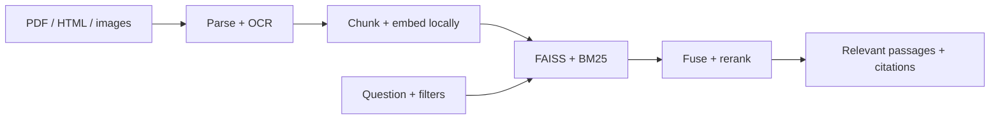
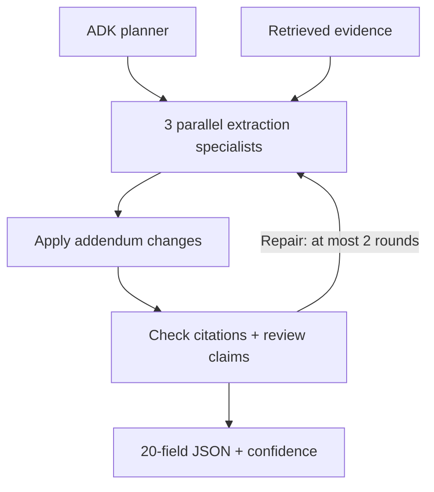
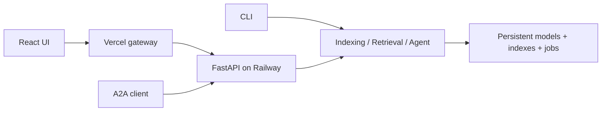

# Architecture

## 1. Find the evidence

| Choice | Implementation |
| --- | --- |
| Chunks | 220 words, 35-word overlap; preserve headings and table headers |
| Embeddings | Local quantized BGE-small ONNX, 384 dimensions |
| Ranking | Dense + keyword rank fusion, then TinyBERT rank blend |
| Storage | Per-bid FAISS snapshots + SQLite metadata; incremental updates |

## 2. Extract the requirements

Specialists cover **dates/logistics**, **commercial/legal**, and **products/specifications**. They exchange validated messages through per-run state. Unresolved fields remain explicit nulls or partial results.

Q&A takes the shorter path: **retrieve → ADK answer → evidence review → cited answer or abstention**.

## 3. Serve the application

| Module | Responsibility |
| --- | --- |
| `ingestion/indexing.py` | Parsing, OCR, chunking and index snapshots |
| `search/retrieval.py` | Filters, FAISS/BM25, rank fusion and citations |
| `agents/agent.py` | Google ADK workflows, validation and reporting |
| `api/` and `cli.py` | Authenticated endpoints, durable jobs and commands |
| `core/` | Configuration, JSON logs, traces and Prometheus metrics |

One backend process/replica owns the local store. API keys stay server-side. [Detailed setup and design decisions](docs/DEVELOPMENT.md)

# Implementation details

The same `Indexing`, `Retrieval` and `Agent` facades serve the CLI, authenticated FastAPI API and Google ADK A2A adapter. This is one process with local models and one persistent store, targeting one replica with 1 GB RAM / one CPU. Groq hosts the language model; embeddings, ranking, parsing and OCR run locally.

## Agent communication

`src/rfp/agents/agent.py` calls Google ADK `LlmAgent` instances through `Runner`, with a separate in-memory ADK session per call. The model adapter is LiteLLM backed by Groq `openai/gpt-oss-120b`. Pydantic schemas validate model messages. The Python facade owns a bounded workflow; the planner returns a plan within that workflow rather than executing arbitrary commands.

Three specialists cover dates/logistics, commercial/legal details and products/specifications. `asyncio.gather` runs them concurrently. They receive retrieved passages and return distinct field groups; typed run state holds the evidence registry, drafts, validation feedback, retry counts and final output. The reconciler receives base and addendum evidence. A deterministic validator checks citation identity and value format; a model critic reviews evidence support. Targeted repair is bounded. Persistent failures produce null values and explicit errors/partial status.

Ingestion and retrieval are deterministic agent roles implemented as tools, not extra LLM calls. A2A exposes one root workflow through the ADK adapter; agents within this process communicate through typed state and validated outputs, without separate HTTP services. A2A discovery and RPC use the same API-key middleware as the REST API.

## Storage and operations

`bids/` contains the supplied input folders. Runtime data lives in `storage/` and model caches in `models/`, both ignored by Git. Docker places both beneath `/var/data`. SQLite persists asynchronous jobs. An atomic snapshot pointer publishes consistent vector/metadata generations; a model/parser/chunking fingerprint prevents incompatible loads. Existing file/chunk hashes support incremental indexing.

The API limits concurrent jobs, searches and model calls. One Uvicorn worker owns the local store. JSON logs and Prometheus record request/stage/model latency, failures, token usage, retries, validation and resource metrics. Content traces are disabled by default. Secrets are excluded from the repository and build context. Public sample traces contain only the supplied assignment documents.

## Design decisions and limits

See README.md for exact chunking, model names, ranking weights, run commands and prompt/validation design. Prompts live in `src/rfp/agents/prompts.py`. Confidence is a heuristic, not a calibrated probability. Evaluation uses 18 development questions across three retrieval configurations; it is not held out. Two of the twelve recorded Q&A answers abstained despite source evidence. The final bid records still contain missing fields that need human review. Semantic answer caching and capability-based go/no-go scoring are not implemented. Token and latency measurement is implemented; monetary cost accounting is not.

