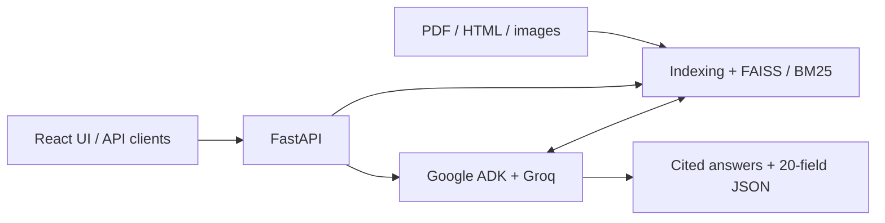
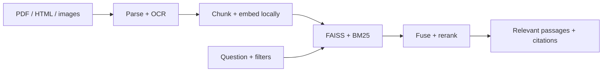
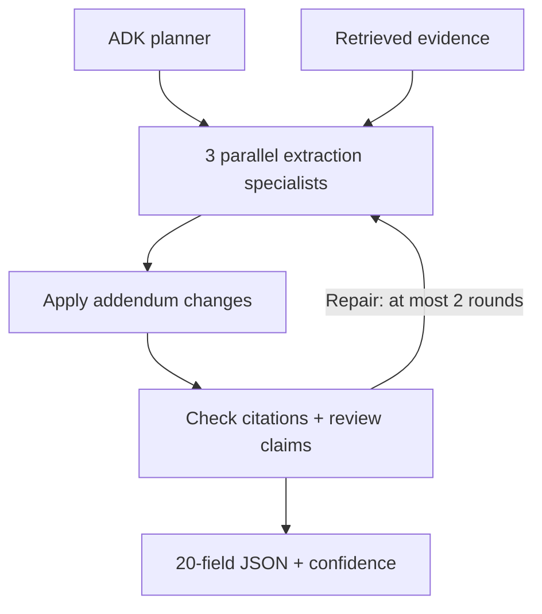
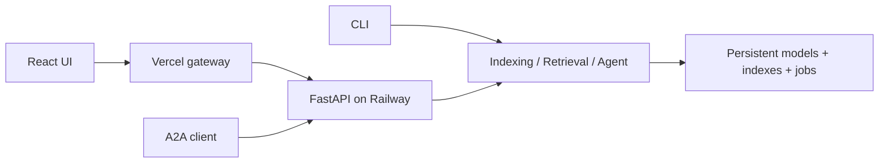

# RFP Intelligence — Agentic RAG

**[Open the live demo](https://rfp-frontend-roan.vercel.app/)**

**OPEN LIVE DEMO (Deployed):** [https://rfp-frontend-roan.vercel.app/](https://rfp-frontend-roan.vercel.app/)

Demo login: `admin@gmail.com` / `admin` · By [Zaheer](https://github.com/zaheer037).

https://github.com/user-attachments/assets/5bf67e6d-3ad5-4c04-986f-ac087b69bea7

[Browser video player](https://rfp-frontend-roan.vercel.app/demo.html) · [Google Drive fallback](https://drive.google.com/file/d/1gLtL16zGsFf8m7f_c9N-Hp1YCBAFMel1/view) · [Download the full narrated demo](demo/Bidwell_Demo_with_voiceover.mp4)

Search bid documents, extract **20 requirements**, and get answers with **source citations**.

**FastAPI · FAISS + BM25 · Google ADK · Groq GPT-OSS 120B · Local ONNX models**

## Measured results

| Check | Result | Evidence |
| --- | --- | --- |
| Hosted browser checks | **34 / 34 passed** | [Production QA](artifacts/production-qa.json) |
| Docker tests, including OCR | **22 passed** | [Test output](artifacts/container-tests.txt) |
| Indexed corpus | **2 bids · 9 documents · 367 passages** | [Production QA](artifacts/production-qa.json) |
| Warm-search requests | **100 / 100 successful** | [Load test](artifacts/load-test-1cpu-1gb.json) |
| Search latency | **p95 1.014 s · p99 1.260 s** | [Load test](artifacts/load-test-1cpu-1gb.json) |
| Peak captured memory | **492.9 MiB** under 1 GiB / 1 CPU | [Resources](artifacts/container-resources.json) |

| Retrieval configuration | Recall@5 | MRR@5 |
| --- | --- | --- |
| Dense | **1.000** | 0.773 |
| Dense + BM25 | 0.944 | 0.780 |
| Dense + BM25 + reranking | 0.944 | **0.807** |

Retrieval uses **18 development questions**. Load/memory figures are local measurements; hosted checks are a separate snapshot. [Evaluation report](artifacts/retrieval-evaluation.json)

## Architecture



### 1. Find the evidence



| Choice | Implementation |
| --- | --- |
| Chunks | 220 words, 35-word overlap; preserve headings and table headers |
| Embeddings | Local quantized BGE-small ONNX, 384 dimensions |
| Ranking | Dense + keyword rank fusion, then TinyBERT rank blend |
| Storage | Per-bid FAISS snapshots + SQLite metadata; incremental updates |

### 2. Extract the requirements



Specialists cover **dates/logistics**, **commercial/legal**, and **products/specifications**. They exchange validated messages through per-run state. Unresolved fields remain explicit nulls or partial results.

Q&A takes the shorter path: **retrieve → ADK answer → evidence review → cited answer or abstention**.

### 3. Serve the application



| Module | Responsibility |
| --- | --- |
| `ingestion/indexing.py` | Parsing, OCR, chunking and index snapshots |
| `search/retrieval.py` | Filters, FAISS/BM25, rank fusion and citations |
| `agents/agent.py` | Google ADK workflows, validation and reporting |
| `api/` and `cli.py` | Authenticated endpoints, durable jobs and commands |
| `core/` | Configuration, JSON logs, traces and Prometheus metrics |

One backend process/replica owns the local store. API keys stay server-side. [Detailed setup and design decisions](docs/DEVELOPMENT.md)

## Quick start

Python **3.12**; install Tesseract for local OCR or use Docker.

```bash
git clone https://github.com/zaheer037/rfp-intelligence-.git
cd rfp-intelligence-
python3.12 -m venv .venv
. .venv/bin/activate
pip install -r requirements.lock
pip install -e '.[dev]'
cp .env.example .env
```

Set `GROQ_API_KEY` and `RFP_API_KEY` (at least 24 characters), then:

```bash
rfp serve
```

| Mode | Command |
| --- | --- |
| Index supplied bids | `rfp index Bid1` then `rfp index Bid2` |
| Search evidence | `rfp search 'submission deadline' --bid-id Bid1` |
| Extract requirements | `rfp extract Bid1` |
| Ask a question | `rfp ask 'Compare warranty requirements.'` |
| Full ingestion + extraction | `rfp run Bid1` |
| Docker | `docker compose up --build` |

## Assumptions & Known Limitations

### Assumptions

- **Addenda precedence:** Addenda override original bid details only when supported by field-specific before/after evidence.
- **Citations:** PDF page numbers are 1-based physical indexes; HTML citations use section locators.
- **LLM:** Groq GPT-OSS 120B is used for planning, extraction, reconciliation, review, and Q&A. Ingestion, retrieval, and evaluation run locally without an LLM.
- **Evaluation scope:** Results and ranking configurations were tested only on Bid1 and Bid2.
- **Document scope:** Only files in the bid folders are indexed; external links are not fetched.

### Chunking Strategy

- Target: 220 words per chunk, with 35-word overlap.
- Heading- and page-aware splitting preserves context.
- Long table rows retain column headers.
- Other chunk sizes have not been benchmarked.

### Known Limitations

- **Confidence:** Scores are heuristic, not calibrated probabilities.
- **Evaluation:** Only 18 development questions were labeled; results are not held-out. Dense retrieval achieved Recall@5 of 1.000; hybrid retrieval achieved 0.944. MRR@5 improved from 0.780 to 0.807 with reranking.
- **False negatives:** Two of 12 recorded Q&A answers failed to find available evidence, including Bid1's contract term (3 years plus two 1-year extensions).
- **Bid1 issues:** The due date has a CST/EDT discrepancy requiring human review. Five fields are missing: Delivery Date, Bid Bond Requirement, Payment Terms, Model_no, and Part_no.
- **Bid2 issues:** Product quantities (30 laptops and 30 docks) and the Contract Affidavit are omitted from extracted fields. Several fields, including Pre Bid Meeting, Installation, and Bid Bond Requirement, are missing. The 90-day bid term represents proposal validity, not contract duration.
- **Extraction reliability:** Known issues remain unresolved in generated artifacts; repeated runs may produce different omissions. `completed` means processing finished, not that extraction is complete.
- **Unimplemented features:** No automated go/no-go decisions, configurable company capabilities, semantic answer caching, monetary cost tracking, or structured comparison schema.
- **OCR:** Tesseract is required for local scanned-document processing.
- **Runtime:** Python 3.11–3.13 is supported. FAISS snapshots and SQLite are local, single-process storage and do not support horizontal scaling.
## More

[Bid1 JSON](artifacts/Bid1.json) · [Bid2 JSON](artifacts/Bid2.json) · [Cited Q&A](artifacts/qa-log.json) · [Agent trace](artifacts/sample-trace.jsonl) · [Full docs: setup, API, design decisions](docs/DEVELOPMENT.md) · [Railway](RAILWAY.md) · [Checklist](DELIVERABLES.md) · [Frontend repo](https://github.com/zaheer037/rfp-frontend)
